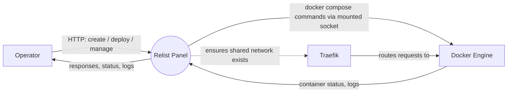
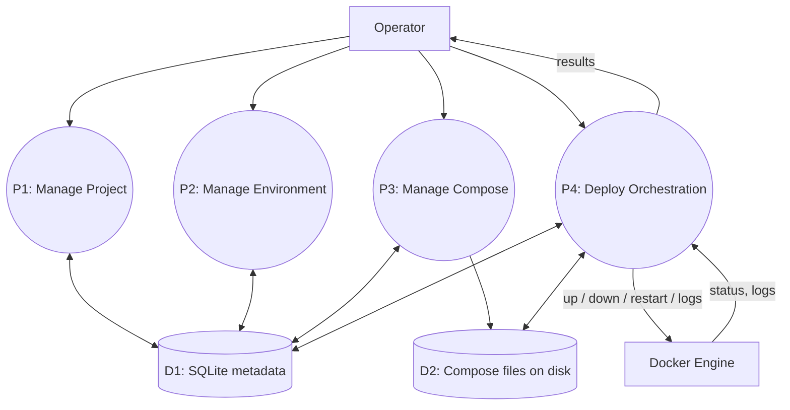
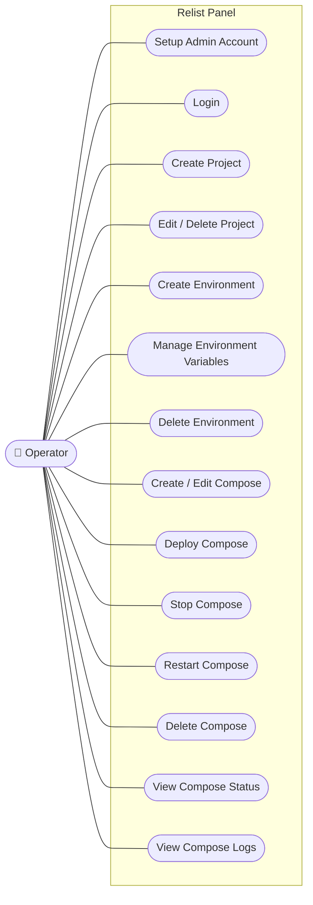
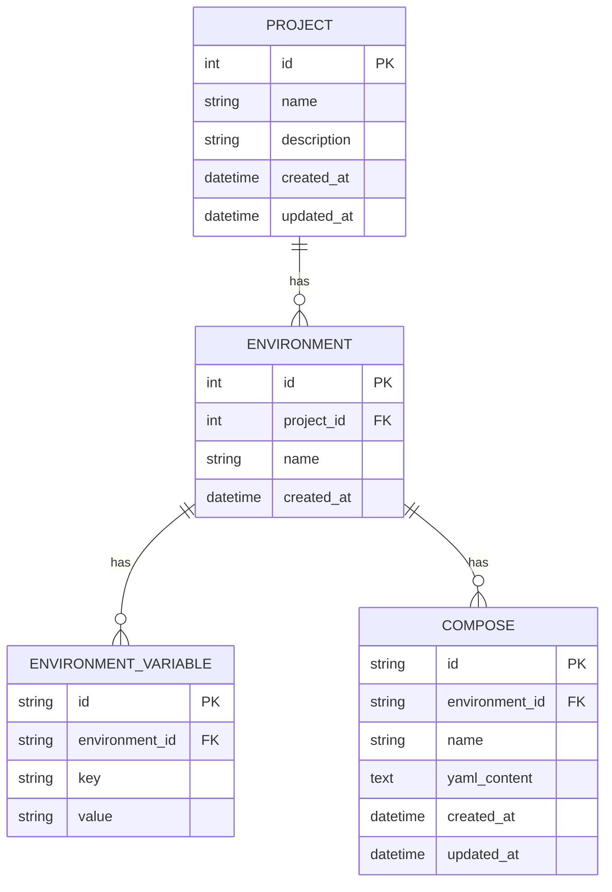
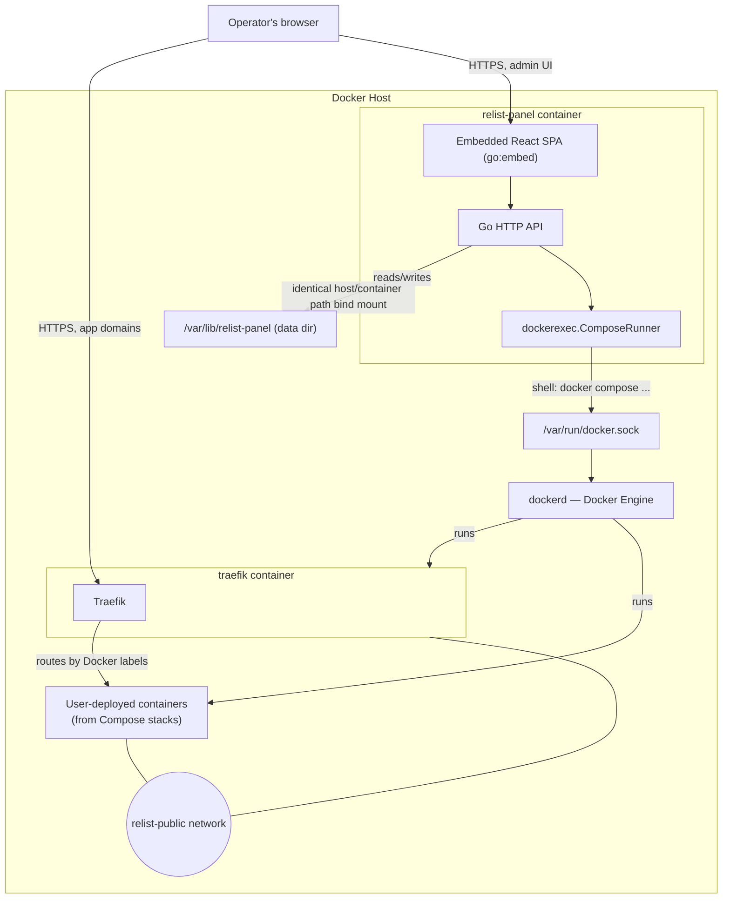
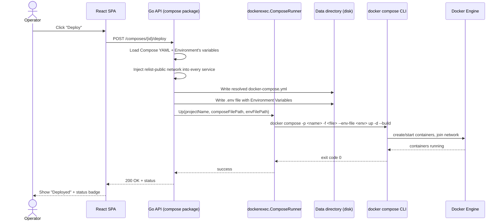

# System Analysis — Relist Panel

This document translates the decisions already recorded in `CONTEXT.md`, `docs/adr/*`, and `.scratch/compose-panel/spec.md` into standard SA diagrams (Context/DFD, Use Case, ER, Architecture, Sequence) and a Data Dictionary. It's a derived reference, not a new source of truth — if anything here ever disagrees with those documents, they win; update this file to match.

## 1. Context Diagram (DFD Level 0)

## 2. Data Flow Diagram — Level 1

## 3. Use Case Diagram

Single actor for v1 — no multi-user/team support (ADR-0001).

### Use case summary

Full flows are in the spec's User Stories (`.scratch/compose-panel/spec.md`) — this table is a condensed index, not a duplicate.

| # | Use Case | Precondition | Postcondition | Spec user stories |
|---|---|---|---|---|
| UC1 | Setup Admin Account | No admin account exists yet | Admin account created | 5 |
| UC2 | Login | Admin account exists | Session established | 6 |
| UC3 | Create Project | Logged in | New Project exists | 7 |
| UC4 | Edit / Delete Project | Project exists | Project updated, or removed with its Environments/Composes torn down | 9, 10 |
| UC5 | Create Environment | Project exists | New Environment exists under the Project | 11, 12 |
| UC6 | Manage Environment Variables | Environment exists | Variable set added/edited/removed | 14, 15 |
| UC7 | Delete Environment | Environment exists | Environment removed, its Composes torn down | 16 |
| UC8 | Create / Edit Compose | Environment exists | Compose YAML saved | 17–20 |
| UC9 | Deploy Compose | Compose exists with YAML | Containers running, network joined, status updated | 22–25, 29 |
| UC10 | Stop Compose | Compose is deployed | Containers stopped, YAML retained | 26 |
| UC11 | Restart Compose | Compose is deployed | Containers cycled | 27 |
| UC12 | Delete Compose | Compose exists | Containers/network/volumes removed, files deleted | 28 |
| UC13 | View Compose Status | Compose exists | Current running/stopped state shown | 21, 30 |
| UC14 | View Compose Logs | Compose is/was deployed | Recent log lines shown | 31 |

## 4. Entity-Relationship Diagram

## 5. System Architecture Diagram

## 6. Sequence Diagram — Deploy Compose

## 7. Data Dictionary

Illustrative — the goose migration files (ADR-0003) are the authoritative schema once written; this is a planning reference.

### `projects`

| Field | Type | Constraint | Description |
|---|---|---|---|
| id | INTEGER | PK | Unique project identifier |
| name | TEXT | NOT NULL, UNIQUE | Project name |
| description | TEXT | NULL | Free-text description |
| created_at | DATETIME | NOT NULL | Creation timestamp |
| updated_at | DATETIME | NOT NULL | Last edit timestamp |

### `environments`

| Field | Type | Constraint | Description |
|---|---|---|---|
| id | INTEGER | PK | Unique environment identifier |
| project_id | INTEGER | FK → `projects.id`, NOT NULL | Owning project |
| name | TEXT | NOT NULL | e.g. "production" |
| created_at | DATETIME | NOT NULL | Creation timestamp |

Unique constraint: (`project_id`, `name`)

### `environment_variables`

| Field | Type | Constraint | Description |
|---|---|---|---|
| id | TEXT | PK | Unique identifier |
| environment_id | TEXT | FK → `environments.id`, NOT NULL | Owning environment |
| key | TEXT | NOT NULL | Variable name |
| value | TEXT | NOT NULL | Variable value |

Unique constraint: (`environment_id`, `key`)

### `composes`

| Field | Type | Constraint | Description |
|---|---|---|---|
| id | TEXT | PK | Unique identifier |
| environment_id | TEXT | FK → `environments.id`, NOT NULL | Owning environment |
| name | TEXT | NOT NULL | Compose name/slug |
| yaml_content | TEXT | NOT NULL | Raw `docker-compose.yml` content as saved |
| created_at | DATETIME | NOT NULL | Creation timestamp |
| updated_at | DATETIME | NOT NULL | Last edit timestamp |

Unique constraint: (`environment_id`, `name`)
